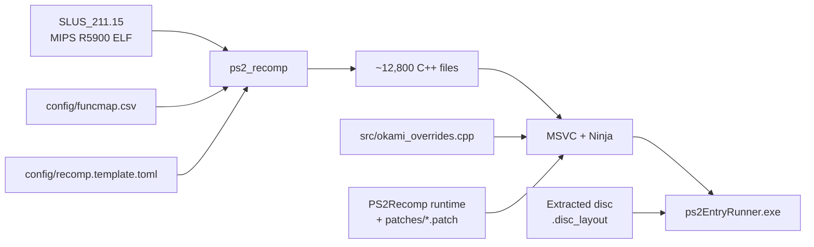

# Okami — PS2 Static Recompilation

English · [Português (Brasil)](README.pt-BR.md)

A native PC port of **Okami** (PS2, NTSC-U `SLUS-21115`) built by statically recompiling MIPS R5900 machine code to C++ using [PS2Recomp](https://github.com/ran-j/ps2recomp) and a native PC runtime.

> [!IMPORTANT]
> **This repository does not contain any game files** (ISO, executable, IRX modules, or `.AFS` assets), nor the C++ code generated from them. You need your own legally acquired copy of Okami for the PlayStation 2.

---

## Contents
- [What is this?](#what-is-this)
- [How it works](#how-it-works)
- [Current status](#current-status)
- [Repository layout](#repository-layout)
- [Requirements](#requirements)
- [Building and running](#building-and-running)
- [Automated error fixing](#automated-error-fixing)
- [Credits and license](#credits-and-license)

---

## What is this?

Instead of emulating the PlayStation 2 hardware through a virtual machine, this project translates the game's original executable (`SLUS_211.15`) into C++ with [PS2Recomp](https://github.com/ran-j/PS2Recomp) and compiles it into a native 64-bit Windows program.

Every piece of PS2 hardware is discarded in favor of native PC subsystems:

| Layer | Native Replacement |
|---|---|
| **EE CPU (Game Code)** | Static recompilation to C++ (12,806 functions) |
| **GS (Graphics)** | Native OpenGL renderer with render targets, 2x+ internal resolution, texture/CLUT store without VRAM emulation |
| **VU1 (Vector Microcode)** | Microprograms compiled ahead of time (AOT) to C++ |
| **IOP (I/O Processor)** | Native HLE services and AOT-compiled IRX modules |
| **Sound (SPU2 / ADX)** | Host sound engine driven by LIBSD calls and native CRI ADX audio streaming |
| **Pad / Memory Card** | Native SDL2 / DirectInput / XInput, files saved to PC storage |
| **DMA / VIF / GIF** | Direct GPU packet dispatch, no DMA controller model |
| **Disc (CD/DVD)** | Files extracted from the disc with exact sector mapping (`.disc_layout`), no ISO reading |

---

## How it works



---

## Current status

See [docs/ESTADO.md](docs/ESTADO.md) for detailed notes and research log.

| Milestone | Status |
|---|---|
| Disc extraction with sector mapping (`.disc_layout`) | ✅ Done |
| MIPS R5900 ELF function map (`config/funcmap.csv`) | ✅ Done (12,806 functions) |
| Recompiler configuration (`recomp.template.toml`) | ✅ Done (0 errors, 0 warnings) |
| Native PC runtime patch stack | ✅ Done (40 patches) |
| Automated error pattern analysis tool | ✅ Done (`tools/analisar_erros.py`) |
| Native compilation (`scripts/2_compilar.cmd`) | 🔧 In progress |
| OpenGL GS rendering & window presentation | ⏳ Pending |
| Native sound (libsd / ADX streaming) | ⏳ Pending |
| Input mapping (controller & keyboard) | ⏳ Pending |
| Full playthrough | ⏳ Future |

---

## Repository layout

```
.
├── AGENTS.md                  # Guidelines for coding agents & contributors
├── config/
│   ├── funcmap.csv            # Function map (Name, Start, End, Size)
│   └── recomp.template.toml   # PS2Recomp configuration template
├── docs/                      # Technical documentation
│   ├── ARQUITETURA.md         # Architecture overview
│   ├── CONTROLES.md           # Controls and runtime shortcuts
│   ├── DESEMPENHO.md          # Performance and optimization
│   ├── ESTADO.md              # Research log and milestone progress
│   └── RENDERIZACAO.md        # OpenGL graphics pipeline
├── game/                      # YOUR extracted disc files (git-ignored)
├── patches/                   # Runtime patches for native PC subsystems
├── scripts/                   # Build and launch scripts for Windows
│   ├── 1_instalar_ferramentas.cmd
│   ├── 2_compilar.cmd         # Full compilation pipeline
│   ├── 2_recompilar_rapido.cmd # Fast rebuild of overrides
│   ├── 3_executar.cmd         # Run game for 60 seconds with logs
│   ├── 3_executar_manual.cmd  # Run game indefinitely
│   └── *.ps1                  # PowerShell script backends
├── src/                       # Game-specific overrides
│   ├── okami_overrides.cpp
│   └── okami_overrides.h
└── tools/                     # Automation utilities
    ├── analisar_erros.py      # Automated error pattern analyzer
    ├── auto_fix.py            # Automated batch fixer
    ├── elf_functions.py       # Function boundary and stub generator
    └── iso_extract.py         # Disc extractor with layout index
```

---

## Requirements

- **Windows 10/11 x64**
- [Visual Studio 2022 / 2026 Build Tools](https://visualstudio.microsoft.com/downloads/) with C++ Desktop workload (includes CMake and Ninja)
- [Git](https://git-scm.com/)
- [Python 3.10+](https://www.python.org/)
- Your own legal copy of **Okami** (PS2, NTSC-U `SLUS-21115`)

`scripts\1_instalar_ferramentas.cmd` will install Git and Build Tools via winget if needed.

---

## Building and running

### 1. Extract the disc
Extract files while preserving original disc sector mappings:
```cmd
python tools\iso_extract.py "D:\Okami (USA).iso" game --layout
```

### 2. Compile the native executable
```cmd
scripts\2_compilar.cmd
```
This script clones PS2Recomp into a short work path (`C:\okamiport`), applies the native runtime patches, translates `SLUS_211.15` to C++, and compiles `ps2EntryRunner.exe` with MSVC and Ninja. Output is logged to `logs\2_compilar.log`.

### 3. Run
```cmd
scripts\3_executar.cmd          :: Runs with 60-second limit and logs
scripts\3_executar_manual.cmd   :: Runs with no time limit
```

- **F2**: Toggle in-game FPS counter.
- **F11**: Toggle borderless fullscreen / windowed mode.
- **F1**: Toggle runtime debugger overlay.

---

## Automated error fixing

When compiling or running, errors may arise due to game-specific nuances.
Okami Recomp includes automated pattern recognition tools:
```cmd
:: Scan compilation log and group errors by recurring patterns:
python tools\analisar_erros.py logs\2_compilar.log

:: Apply automated batch fixes (stubs, headers, configs):
python tools\auto_fix.py logs\2_compilar.log
```

---

## Credits and license

- [PS2Recomp](https://github.com/ran-j/PS2Recomp) by ran-j and contributors — recompiler and runtime framework (GPL-3.0).
- [God of War Recomp](https://github.com/KIexster/god-of-war-recomp) by KIexster and contributors — reference architecture and native pipeline.
- [God-Of-War-Native-Port](https://github.com/Waffle565/God-Of-War-Native-Port) by Waffle565 — native runtime base (GS, VU1, IOP, sound, disc layout).
- [PCSX2](https://github.com/PCSX2/pcsx2) contributors — reference GS and EE implementations (GPL-3.0+).
- Okami © Capcom / Clover Studio. This project is not affiliated with or endorsed by Capcom. No game assets are distributed.

Released under the **GPL-3.0 License** (see [LICENSE](LICENSE)).
