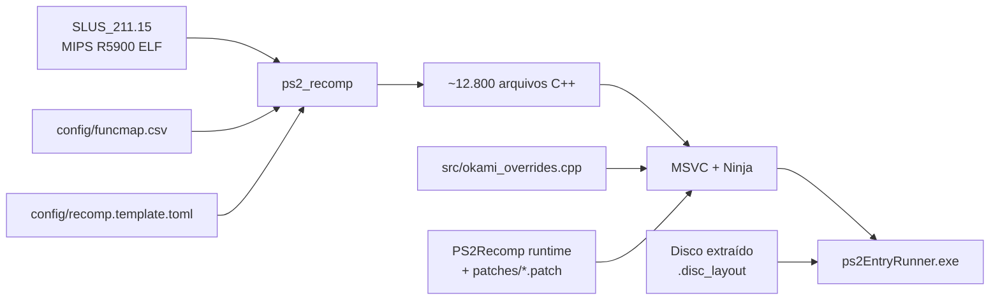
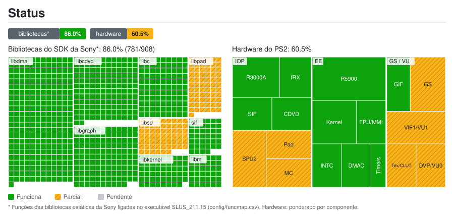

# Okami — Recompilação Estática para PS2

[English](README.md) · Português (Brasil)

Um port nativo para PC de **Okami** (PS2, NTSC-U `SLUS-21115`) construído através da recompilação estática do código MIPS R5900 original para C++ usando o [PS2Recomp](https://github.com/ran-j/ps2recomp) e um runtime nativo moderno para PC.

> [!IMPORTANT]
> **Este repositório não contém arquivos do jogo** (ISO, executável, módulos IRX ou arquivos de dados `.AFS`), nem o código C++ gerado a partir deles. Você precisa de sua própria cópia legal de Okami para o PlayStation 2.

---

## Conteúdo
- [O que é isso?](#o-que-é-isso)
- [Como funciona](#como-funciona)
- [Status atual](#status-atual)
- [Estrutura do repositório](#estrutura-do-repositório)
- [Requisitos](#requisitos)
- [Compilando e executando](#compilando-e-executando)
- [Correção automatizada de erros](#correção-automatizada-de-erros)
- [Créditos e licença](#créditos-e-licença)

---

## O que é isso?

Em vez de emular o hardware do PlayStation 2 por meio de uma máquina virtual, este projeto traduz o executável original do jogo (`SLUS_211.15`) em código C++ com o [PS2Recomp](https://github.com/ran-j/PS2Recomp) e o compila em um programa nativo de 64 bits para Windows.

Todas as peças de hardware do PS2 são descartadas em favor de subsistemas nativos do computador:

| Camada PS2 | Substituição Nativa no PC |
|---|---|
| **EE CPU (Código do Jogo)** | Recompilação estática para C++ (12.806 funções) |
| **GS (Gráficos)** | Renderizador OpenGL com alvos de renderização (FBO) e resolução interna 2x+; armazenamento de texturas/CLUT sem emulação de VRAM |
| **VU1 (Microcódigo Vetorial)** | Microprogramas compilados antecipadamente (AOT) para C++ |
| **IOP (Processador de E/S)** | Serviços HLE nativos e módulos IRX compilados AOT |
| **Som (SPU2 / ADX)** | Motor de som nativo guiado por chamadas LIBSD e streaming ADX nativo |
| **Controle / Memory Card** | Serviços nativos via SDL2 / DirectInput / XInput, salvamento no disco do PC |
| **DMA / VIF / GIF** | Despacho direto de pacotes para a GPU e VU1, sem emulador de controlador DMA |
| **Disco (CD/DVD)** | Arquivos extraídos com mapeamento exato de setores (`.disc_layout`), sem leitura de ISO |

---

## Como funciona



---

## Status atual

<a href="docs/estado/detalhes.pt-BR.md"></a>

Detalhamento por biblioteca e componente: [`docs/estado/detalhes.pt-BR.md`](docs/estado/detalhes.pt-BR.md). Regenerado a partir de `docs/estado/dados.toml` por `tools/estado/gerar.py` (e automaticamente em cada push para `main`).

Consulte [docs/ESTADO.md](docs/ESTADO.md) para o registro detalhado de pesquisa.

| Marco | Status |
|---|---|
| Extração do disco com mapeamento de setores (`.disc_layout`) | ✅ Concluído |
| Mapeamento de funções do ELF MIPS R5900 (`config/funcmap.csv`) | ✅ Concluído (12.806 funções) |
| Configuração do recompilador (`recomp.template.toml`) | ✅ Concluído (0 erros, 0 avisos) |
| Pilha de patches do runtime nativo | ✅ Concluído (40 patches) |
| Ferramenta de análise automatizada de padrões de erro | ✅ Concluído (`tools/analisar_erros.py`) |
| Compilação nativa (`scripts/2_compilar.cmd`) | 🔧 Em progresso |
| Renderização gráfica GS OpenGL & apresentação em janela | ⏳ Pendente |
| Som nativo (libsd / streaming ADX) | ⏳ Pendente |
| Mapeamento de controles (gamepad e teclado) | ⏳ Pendente |
| Jogo completo jogável | ⏳ Futuro |

---

## Requisitos

- **Windows 10/11 x64**
- [Visual Studio 2022 / 2026 Build Tools](https://visualstudio.microsoft.com/downloads/) com a carga de trabalho C++ (inclui CMake e Ninja)
- [Git](https://git-scm.com/)
- [Python 3.10+](https://www.python.org/)
- Sua própria cópia de **Okami** (PS2, NTSC-U `SLUS-21115`)

`scripts\1_instalar_ferramentas.cmd` instala o Git e o compilador C++ via winget caso necessário.

---

## Compilando e executando

### 1. Extrair o disco
Extrai os arquivos preservando os setores exatos do disco:
```cmd
python tools\iso_extract.py "D:\Okami (USA).iso" game --layout
```

### 2. Compilar o executável nativo
```cmd
scripts\2_compilar.cmd
```
O script clona o PS2Recomp em `C:\okamiport`, aplica os patches nativos, traduz `SLUS_211.15` para C++ e compila `ps2EntryRunner.exe` com MSVC e Ninja. O log é gerado em `logs\2_compilar.log`.

### 3. Executar
```cmd
scripts\3_executar.cmd          :: Executa por 60 segundos com registro de logs
scripts\3_executar_manual.cmd   :: Executa sem limite de tempo
```

- **F2**: Alterna contador de FPS na tela.
- **F11**: Alterna entre tela cheia sem bordas e janela.
- **F1**: Alterna depurador visual do runtime.

---

## Correção automatizada de erros

Ao rodar e compilar, múltiplos erros podem surgir decorrentes de particularidades do código do jogo.
O Okami Recomp conta com ferramentas automatizadas para agrupar problemas por padrão e consertar vários de uma só vez:

```cmd
:: Analisa o log de compilacao e agrupa erros recorrentes por padroes:
python tools\analisar_erros.py logs\2_compilar.log

:: Aplica correções automáticas em lote (stubs faltantes, headers, configs):
python tools\auto_fix.py logs\2_compilar.log
```

---

## Créditos e licença

- [PS2Recomp](https://github.com/ran-j/PS2Recomp) por ran-j e colaboradores — framework de recompilação e runtime (GPL-3.0).
- [God of War Recomp](https://github.com/KIexster/god-of-war-recomp) por KIexster e colaboradores — projeto de referência e pipeline nativo.
- [God-Of-War-Native-Port](https://github.com/Waffle565/God-Of-War-Native-Port) por Waffle565 — base de runtime nativo (GS, VU1, IOP, áudio, disco).
- Contribuidores do [PCSX2](https://github.com/PCSX2/pcsx2) — implementações de referência para GS e EE (GPL-3.0+).
- Okami © Capcom / Clover Studio. Este projeto não possui afiliação com a Capcom. Nenhum arquivo comercial do jogo é distribuído.

Código licenciado sob a licença **GPL-3.0** (consulte [LICENSE](LICENSE)).
