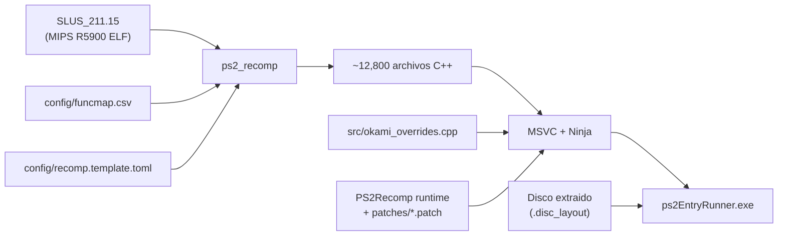

# Arquitectura de Okami Recomp

Port nativo para PC de *Okami* (PS2, `SLUS-21115`) basado en recompilacion estatica con
[PS2Recomp](https://github.com/ran-j/PS2Recomp) y el runtime nativo de Waffle565 / God of War Recomp.

## Filosofia: Descarte de emulacion de PS2

En lugar de emular el hardware de la consola PlayStation 2 en tiempo real, el proyecto traduce
el ejecutable MIPS R5900 original (`SLUS_211.15`) directamente a C++ por adelantado (AOT) y
lo enlaza contra un runtime nativo moderno de PC.

| Capa PS2 | Reemplazo Nativo en PC |
|---|---|
| **EE CPU (Codigo del juego)** | Recompilacion estatica a C++ con `ps2_recomp` (12.806 funciones identificadas) |
| **GS (Graphics Synthesizer)** | Renderizador nativo OpenGL con objetivos de renderizado y escalado interno (2x+); almacenamiento de texturas/CLUT sin modelo pesado de VRAM |
| **VU1 (Vector Unit 1)** | Microprogramas vectoriales compilados AOT a C++ (sin interprete lento de microcodigo) |
| **IOP (I/O Processor)** | Modulos IRX del juego compilados AOT a C++ con `tools/iop/iopn_gen.py` o despachados via servicios nativos HLE |
| **Sonido (SPU2 / ADX)** | Motor de sonido nativo host guiado por llamadas a libsd y streaming de audio ADX nativo |
| **Mandos / Memory Card** | Servicios nativos SDL2 / DirectInput / XInput, guardado directo en sistema de archivos del PC |
| **DMA / VIF / GIF** | Despacho directo de paquetes a la GPU y a la VU1 nativa sin emulacion de controlador DMA |
| **Disco (CD/DVD)** | Archivos extraidos con mapeo de sectores (`.disc_layout`), sin necesidad de montar ni leer archivos ISO |

## Flujo del Pipeline

## Subsistemas Clave

1. **Gestor de Disco (`tools/iso_extract.py`)**:
   Extrae `_DATA0.AFS`, `_DATA1.AFS`, `MODULES/`, etc., preservando sus numeros de sector exactos en `.disc_layout` y metadatos en `.disc_meta`. El runtime sirve lecturas directas por LBN de forma instantanea sin latencias de emulacion de lente.

2. **Diagnostico y Automatizacion de Errores**:
   - `tools/analisar_erros.py`: Agrupa y categoriza errores recurrentes en logs.
   - `tools/auto_fix.py`: Repara en lote stubs no resueltos y configuraciones faltantes.
