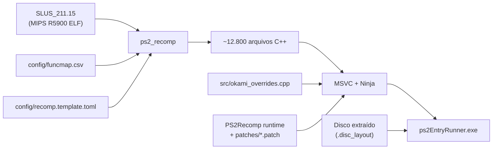

# Arquitetura do Okami Recomp

Port nativo para PC de *Okami* (PS2, `SLUS-21115`) baseado em recompilação estática com
[PS2Recomp](https://github.com/ran-j/PS2Recomp) e o runtime nativo de Waffle565 / God of War Recomp.

## Filosofia: Descarte Total da Emulação de PS2

Em vez de emular o hardware do console PlayStation 2 em tempo real, este projeto traduz
o executável MIPS R5900 original (`SLUS_211.15`) diretamente para C++ de forma antecipada (AOT) e
o compila com os subsistemas nativos do computador.

| Camada PS2 | Substituição Nativa no PC |
|---|---|
| **EE CPU (Código do Jogo)** | Recompilação estática para C++ com `ps2_recomp` (12.806 funções identificadas) |
| **GS (Graphics Synthesizer)** | Renderizador nativo OpenGL com render targets e resolução interna escalável (2x+); armazenamento de texturas/CLUT sem emulação de VRAM por software |
| **VU1 (Vector Unit 1)** | Microprogramas vetoriais compilados AOT para C++ (sem interpretador lento de microcódigo) |
| **IOP (Processador de E/S)** | Módulos IRX do jogo compilados AOT para C++ com `tools/iop/iopn_gen.py` ou despachados via serviços nativos de alto nível (HLE) |
| **Som (SPU2 / ADX)** | Motor de som nativo guiado por chamadas libsd e streaming direto de áudio CRI ADX nativo |
| **Controles / Memory Card** | Serviços nativos SDL2 / DirectInput / XInput, salvamento direto no sistema de arquivos do PC |
| **DMA / VIF / GIF** | Despacho direto de pacotes para a GPU e VU1 nativa sem modelo de controlador DMA |
| **Disco (CD/DVD)** | Arquivos extraídos com mapeamento de setores (`.disc_layout`), sem necessidade de montar ou ler imagens ISO |

## Fluxo do Pipeline

## Subsistemas Principais

1. **Gerenciador de Disco (`tools/iso_extract.py`)**:
   Extrai `_DATA0.AFS`, `_DATA1.AFS`, `MODULES/`, etc., preservando os números de setores originais em `.disc_layout` e metadados em `.disc_meta`. O runtime atende às leituras por LBN de forma instantânea sem latências mecânicas de lente.

2. **Diagnóstico e Automação de Erros**:
   - `tools/analisar_erros.py`: Agrupa e categoriza erros recorrentes em logs.
   - `tools/auto_fix.py`: Corrige em lote stubs não resolvidos e configurações pendentes.
