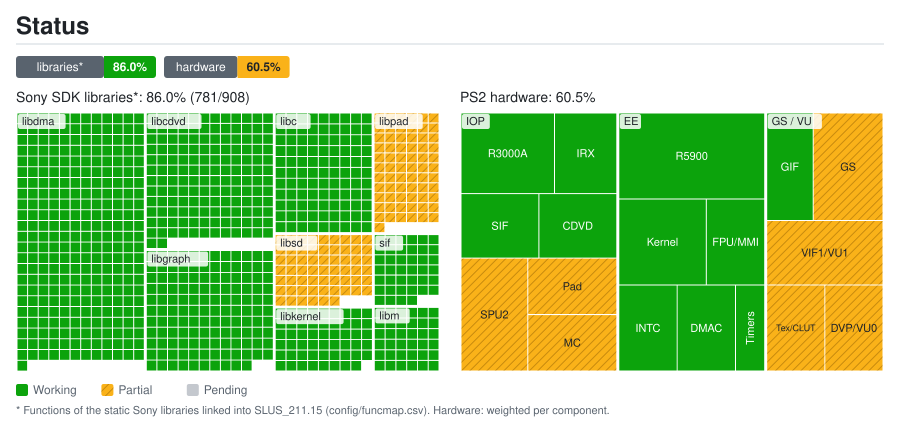

# Port status: details

Generated automatically by `tools/estado/gerar.py` from `docs/estado/dados.toml` and `config/funcmap.csv`. Do not edit by hand.

## Sony SDK libraries*: 86.0% (781/908)

| Library | Functions | Status | Note |
|---|---:|---|---|
| `libgraph` | 130 | ✅ Working | Native OpenGL render-target renderer (FBO), 2x+ internal resolution |
| `libdma` | 277 | ✅ Working | DMA chains dispatched straight to GPU and VIF1/VU1 with reusable buffers |
| `libcdvd` | 146 | ✅ Working | Reads disc files directly from exact sector layout (.disc_layout) |
| `libpad` | 67 | 🔧 Partial | Native controller service (DualShock 2 / gamepad / keyboard via SDL2) |
| `libsd` | 60 | 🔧 Partial | Native sound engine driven by LIBSD calls and CRI ADX streaming |
| `libkernel` | 53 | ✅ Working | EE Kernel: threads, semaphores, alarms and interrupt dispatch |
| `sif` | 40 | ✅ Working | SIF communication: EE ↔ IOP RPC and DMA |
| `libc` | 99 | ✅ Working | Standard C library (text formatting, memory and utilities) |
| `libm` | 36 | ✅ Working | Floating point math routines with x86-64 MXCSR rounding control |

## PS2 hardware: 60.5%

| Group | Component | Weight | Status | Note |
|---|---|---:|---|---|
| EE | R5900 CPU (recompiled to C++) | 5 | ✅ Working | 12,806 functions statically recompiled to x64 C++ |
| EE | Kernel: threads, semaphores and alarms | 3 | ✅ Working |  |
| EE | FPU (COP1) and MMI instructions | 2 | ✅ Working |  |
| EE | INTC: VSync and GS interrupt | 2 | ✅ Working |  |
| EE | Native DMA controller | 2 | ✅ Working | DMA chains go straight to GPU without bus emulation |
| EE | Native timers | 1 | ✅ Working |  |
| GS / VU | GS: primitives and framebuffer | 3 | 🔧 Partial | Native OpenGL renderer with 2x+ internal resolution |
| GS / VU | VIF1 and VU1 | 3 | 🔧 Partial | Ahead-of-time microcode and fast UNPACK with DVP overlay support |
| GS / VU | GS: textures and CLUT tables | 2 | 🔧 Partial | Native GPU texture store without eDRAM emulation |
| GS / VU | GIF (PATH1-3) | 2 | ✅ Working |  |
| GS / VU | DVP Overlays / VU0 | 2 | 🔧 Partial | Microcode overlay management via .DVP.ovlytab tables in ELF |
| IOP | R3000A CPU / IRX Modules | 3 | ✅ Working | IRX modules compiled AOT or handled via native HLE |
| IOP | SPU2: audio and CRI ADX streaming | 3 | 🔧 Partial | Native sound engine driven by LIBSD and ADX streaming channels |
| IOP | Original IRX modules | 2 | ✅ Working |  |
| IOP | SIF: EE ↔ IOP RPC and DMA | 2 | ✅ Working |  |
| IOP | CDVD: disc reader with native layout | 2 | ✅ Working | Instant raw reading from original sectors (.disc_layout) |
| IOP | Native DualShock 2 controller | 2 | 🔧 Partial | Native gamepad service supporting XInput and DualSense |
| IOP | Native Memory Card | 2 | 🔧 Partial | Save files stored directly on host filesystem |

* Functions of the static Sony libraries linked into SLUS_211.15 (config/funcmap.csv). Hardware: weighted per component.
